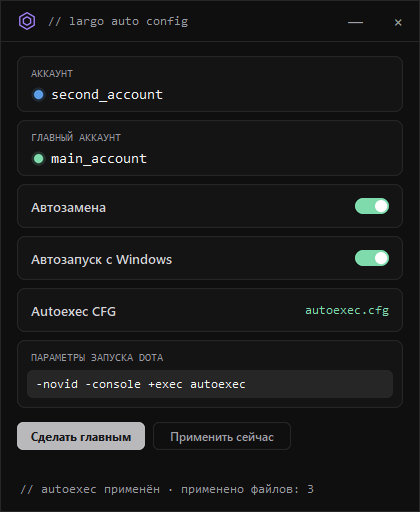

# Largo Auto Config

Трей-приложение от **Largo Develop**: хоткеи и настройки Dota 2 с главного аккаунта автоматически переносятся на любой Steam-аккаунт, на который вы переключаетесь. Плюс общий autoexec и параметры запуска.

<p align="center"></p>

## Как это работает

Ты выбираешь **главный аккаунт** — тот, на котором настроены хоткеи и настройки игры. Когда ты переключаешь Steam на любой другой аккаунт, приложение само копирует эти настройки из `userdata/<главный>/570` в `userdata/<текущий>/570`. Никаких ручных снимков: источник всегда живой, поэтому всё свежее.

Переносится только:

- хоткеи: `remote/cfg/dotakeys_personal.lst`, `user_keys.vcfg`, `local/cfg/user_keys_*.vcfg`
- настройки игры: `user.vcfg`, `user_convars.vcfg`, `local/cfg/user_convars_*.vcfg`, `machine_convars.vcfg`, `video.txt`

Гайды, билды героев, чат, статистика и реплеи не трогаются. Перед заменой изменённые файлы бэкапятся в `profiles/_backup` (хранятся последние 10).

Если Dota запущена, замена откладывается до её закрытия.

### Параметры запуска Dota

Поле «Параметры запуска Dota» (например `-novid -console +exec autoexec`) записывается в `localconfig.vdf` всех аккаунтов, которые заходили в Steam на этом ПК. Steam держит файл активного аккаунта в памяти, поэтому для него параметры подставятся после смены аккаунта или перезапуска Steam. Оригинал `localconfig.vdf` каждого аккаунта один раз сохраняется в `profiles/_localconfig_backup`. Пустое поле ничего не меняет.

## Запуск из исходников

```bash
pip install -r requirements.txt
python app/main.py
```

Опционально скопируй `config.example.json` → `config.json`.

## Сборка EXE

```bash
pip install -r requirements.txt pyinstaller
powershell -ExecutionPolicy Bypass -File build_exe.ps1
```

Готовый файл: `dist/LargoAutoConfig.exe`.

## Как пользоваться

1. Запусти приложение, зайди в Steam на аккаунт с нужными настройками.
2. Нажми **Сделать главным**.
3. Дальше просто меняй аккаунты. Приложение живёт в трее (крестик сворачивает, «Автозапуск с Windows» включается в меню трея).

## Структура

```
app/           — код приложения
assets/        — логотип Largo
defaults/      — запасной autoexec
profiles/      — локальные профили (не в git)
config.json    — локальные настройки (не в git)
```

## Требования

- Windows 10/11
- Steam + Dota 2
- Python 3.11+ (только для запуска из исходников / сборки)

## Лицензия

Проприетарный инструмент Largo Develop. Использование по согласованию с автором.
